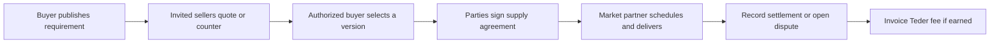

# Teder implementation specification

22 November 2026 · Product and engineering plan for teder.click

This document translates the global energy trading vision in [idiot.md](idiot.md) and the research in [PLAN.md](PLAN.md) into a buildable product. It sets the proposed launch priority. PLAN.md remains the research record, including its earlier certificate pilot hypothesis.

## Product decision

Teder is a private B2B market for **securing deliverable energy and capacity**. A buyer publishes a specific requirement to eligible counterparties. Sellers bid and counter on price, quantity and delivery. The buyer selects an offer, the parties contract, and the authorized participants carry out delivery and settlement.

**First product hypothesis: firm clean power in a defined delivery window.** The first buyer is a power supplier or aggregator with a funded purchase requirement and market access. It needs a commitment for a particular location and schedule, such as weekday evening power that its existing supply cannot cover on attractive terms. A qualified seller may offer generation backed by storage or balancing, subject to the agreed clean-energy criteria and local rules. Teder earns its place by bringing a feasible offer that improves on the buyer's normal options. If buyers can already obtain equivalent offers promptly, do not sell them another portal.

**First pilot:** one buyer, one delivery market, one defined power product, at least two potential sellers and one authorized party able to schedule and settle delivery. Ask the buyer about its last uncovered requirement and normal alternatives, then secure a written mandate for a live purchase. Confirm the access, credit and delivery path before inviting firm offers. Approach companies directly through teder.click and qualified partners. A candidate buyer, supplier or partner is not presumed to exist.

**Success gate:** one comparable, executable alternative the buyer values enough to accept, signed supply terms, externally confirmed delivery or settlement, a paid fee, and a repeat request in the next eligible purchasing cycle. Stop or change the initial market if qualified buyers won't bring a real mandate, no seller can fulfill, or existing channels consistently match or beat Teder. Validate this with a manual tender before expanding the production build. Confirm the specific country, market segment, pricing and authorized partners from that test.

### Global product map

| Product | What is contracted | Physical execution | Teder's role and release order |
| --- | --- | --- | --- |
| Firm power | Energy by delivery point and interval in MW/MWh. Source and attribute obligations are explicit. | Connected grid, authorized supplier or scheduler, and market settlement. | First product. Private requirements, qualified offers, deal confirmation and delivery status. |
| Transportable fuels | Grade, volume, transfer location, window and delivery terms. Examples include crude, refined products, biofuels, biomass, LNG, ammonia and methanol. | Carrier, pipeline, terminal and receiving facility as appropriate. | Extend bids and awards with product-specific quantity, quality and logistics fields when a partner brings a live route. |
| Flexible capacity and frequency response | Available MW, activation conditions, performance and duration. Some products pay separately for energy delivered. | Qualified assets and market operator or aggregator in the relevant grid. | Partner-led. Help an aggregator source assets or prepare submissions to the existing market once it identifies a recurring problem. |
| Local heat and steam | Capacity, pressure or temperature, delivery hours and metered quantity. | On-site equipment or local thermal network. | Later, when a buyer and a deliverable local source justify a workflow. |
| Certificates and financial instruments | A registry attribute or a contractual financial position. | Registry or settlement arrangements specific to the instrument. | Separate future product decisions. Keep these distinct from physical supply. |

A globe may help users explore markets later. Launch screens should list supported delivery markets and accessible requirements. A ship can carry qualifying fuel to a distant terminal. A physical power deal needs an eligible delivery point on a connected grid. Global scope means expanding market by market with the right counterparties and infrastructure.

## Workflow and what the app can enforce

Teder enforces access, approval limits, offer expiry, version selection and its own fee rules. A buyer selects an offer in the first release. The parties become bound through the identified signing process under the agreed terms. Their contract controls remedies and shortfall obligations. The external partner controls scheduling and reports delivery and settlement. The app shows the state and source of that report.

### User experience and screens

| Surface | Main action and required feedback |
| --- | --- |
| `/`, `/about`, `/pricing`, `/announcements` | Explain the first supported product and delivery market. Use **Request a pilot** or **Accept invitation** as the public entry point. Explain who pays and when without inventing a public tariff. |
| `/signup`, `/login`, `/recovery`, `/invite/:token` | Accept the organization or tender invitation, create an account, set up recovery and resume the intended step after authentication. Show expired, revoked and already accepted outcomes with next actions. Signup alone grants no authority to quote or approve. |
| `/app/organizations/:id` and account settings | Organization admin adds legal identity, users and permissions. Show eligibility and trading-authority review with the reason an action is unavailable. Use separate Profile and Security pages. |
| `/app/requests` | Buyer sees drafts, live deadlines and actions that need attention. Supplier sees invited requests and offers belonging to its own organization. First-run screens show the next action. |
| `/app/requests/new` | Start from **Firm power**. Capture delivery point, time zone, schedule, expected MWh, price basis, clean-energy and credit terms. Preview exact commercial terms, choose eligible counterparties and publish. |
| `/app/requests/:id` | Invited seller views the requirement and chooses **Send indicative quote** or **Send firm offer**. Buyer can counter privately. Show term changes by version, expiry and whether volume is full or partial. First release supports a single full-volume award. |
| `/app/requests/:id/compare` | Compare offers with aligned delivery interval, volume, currency, price basis, inclusions, credit, curtailment and expiry. Flag material differences. Require explicit acknowledgment before selecting a nonconforming offer. Review the exact version and fee disclosure before approval. |
| `/app/deals/:id` | Show selected terms and next action. Clearly distinguish **Offer selected**, **Agreement signed**, **Scheduling confirmed**, and **Settlement recorded**. Participants can submit evidence from the authorized market partner and raise a dispute. |
| `/app/billing` | Show the fee basis, trigger, invoice status, adjustments and payer. Keep the supplier's energy invoice and Teder's service invoice distinct. |

Design direction: a quiet trading workspace that puts next actions, delivery terms and exceptions above metrics. Use a comparison table with persistent labels on desktop and expandable comparisons on mobile. Keep the delivery point, time zone, unit and quote validity visible near every price. Use text and icons alongside status color, keyboard-visible focus and accessible field errors. Test at mobile, tablet and desktop sizes. Use the repository's `teder.svg` after checking intended usage, legibility and contrast. Label examples visibly and keep live lists empty until actual data exists. Target [WCAG 2.2 AA](https://www.w3.org/TR/WCAG22/).

### Worked pilot example

Illustration: A seeks 2 MW from 18:00–22:00 local time for 20 delivery days at an eligible delivery point. That's 160 MWh if each window contains four actual hours. One seller offers the full firm profile. Another provides an indicative as-generated offer. Teder displays these as different commitments. A counters on shortfall terms, selects the exact firm version and signs with the seller. The scheduling partner later confirms the schedule and provides settlement references. If delivered volume differs, retain the original commercial terms and open the settlement issue against the affected intervals. Use actual interval durations and the specified market calendar in software.

## Technical stack and repository

**Source status at inspection:** the previous tracked `index-globe/` RedwoodSDK starter is absent from the working tree. `chamin/` is present as an untracked TanStack starter and `teder.svg` is present separately. Use `chamin/` as the proposed implementation base, subject to confirming that it is the intended scaffold before code changes. The existing code has a todo example and a Node-oriented `better-sqlite3` database connection. The dependency list and deploy script alone do not establish Worker readiness.

| Layer | Decision |
| --- | --- |
| Application | Reuse TanStack Start, React, TypeScript, Vite, Tailwind and pnpm from `chamin/`. Use TanStack Router, Query and forms for the role-based screens. Reuse Radix and the existing component conventions. |
| Server API | Use Workers with the existing oRPC and Zod pattern. Build market and trade procedures behind auth. Keep rule and permission checks on the server. Remove or disable todo, sample OpenAPI and MCP routes from the pilot build. |
| Data | Replace the native SQLite adapter with Drizzle over D1. Migrations start with identity, organizations and trade records. Keep a single write authority for the pilot. Test Worker runtime behavior and critical mutations on D1 before connecting counterparties. |
| Account and authority | Reuse Better Auth after proving its adapter and session flows on Workers. Unique username and password with visible availability and validation feedback, verified recovery email, separate Security page, and TOTP or equivalent step-up for signers. Use the project's secure signed session policy with revocable server-side authority, secure HttpOnly cookies and CSRF protection. Gate trading by verified organization membership and explicitly assigned authority. |
| Documents | Private R2 for signed documents, approved supporting records and settlement references. Authorize downloads for the relevant record and organization. Keep object keys and metadata in D1. Apply type, size, scan/quarantine and retention controls before shared access. |
| Notifications | Transactional invitation, offer, expiry and status email. Write an outbox event with the corresponding business change and retry delivery with stable dedupe keys. Keep sensitive terms behind authenticated links. |
| Billing | Manual Teder service invoicing for the pilot. Add collection through a payment provider when fees and authorizations are proven. Direct buyer-to-seller settlement for the energy invoice. |
| Environments | Local and pilot staging first, then a gated Worker deployment. Separate credentials, databases and document storage, with only production pointed at teder.click after verification. Store credentials through the project secret workflow. Use structured logs and avoid logging bid terms, signed documents and signing credentials. |

Engineering references: [Cloudflare D1 Worker API](https://developers.cloudflare.com/d1/worker-api/d1-database/), [Workers R2 API](https://developers.cloudflare.com/r2/api/workers/workers-api-reference/) and [Better Auth Drizzle adapter](https://www.better-auth.com/docs/adapters/drizzle). Add the project-root APP.md when building the app. Use the existing domain teder.click.

### Domain and data contract

- **Market and product.** Store the jurisdiction, operator, delivery point, supported price bases, product version and configured approval steps. Implement only a firm-power schema in the pilot. Future products get their own validated schemas and units. Store the local IANA time zone and UTC interval boundaries so daylight saving and holidays are reviewable. Use fixed precision for price and volume. Record original currency and units and expose any rounding rules.
- **Organizations and users.** Organizations can buy, sell or perform partner functions subject to their scope. Membership roles include admin, buyer, seller, approver, signer and read-only. Record role, approved market, delegated limit and expiry. Invitations are scoped, single use and expiring. Seller access is per tender and own offers. Buyer comparison can include invited sellers' offers. Cross-organization reads and writes require an explicit relationship check.
- **Requests, invites and offers.** Persist delivery intervals, requested MW/MWh, firmness, resource/attribute obligations, price basis, the response deadline and signoff conditions. Offers are versioned, with actor, audience, state, validity, prior version and terms. Counteroffers establish a new version. If the buyer materially changes the request after publishing, ask sellers to reconfirm against the new terms.
- **Awards and agreements.** The award references one exact, eligible version. Use a uniqueness constraint for one active award per request, a server deadline check, an idempotency key, and an atomic conditional write for the award and corresponding audit/outbox records. A stale or duplicate attempt must neither overwrite a selection nor generate another invoice. Test race behavior in D1. Signed agreements are immutable records with signer, timestamps, version and document reference. Amendments become separate, mutually authorized versions.
- **Delivery, disputes and fees.** Store evidence issuer, source reference, effective time, time received and affected intervals. Keep reported and confirmed states distinct. Record corrections and dispute resolution events alongside original records. Store the payer, signed fee schedule, trigger, base, currency, rounding rule, invoice reference and any credit or reversal.
- **API boundaries.** Suggested procedures include `requests.publish`, `requests.invite`, `offers.submit`, `offers.counter`, `awards.select`, `agreements.recordSigned`, `delivery.recordConfirmation`, `settlement.record`, `disputes.open` and `billing.issueInvoice`. Validate ownership, authority, current state and version for each mutation. An operator should only see confidential terms when the parties have granted that role access.

| Record | States and transitions |
| --- | --- |
| Request | Draft → open → closed by award, withdrawal or expiry. |
| Offer version | Indicative or firm → superseded, withdrawn, expired or selected. The award action requires a current firm version. |
| Agreement | Selected → awaiting signatures → signed, cancelled or terminated under the agreed process. |
| Delivery and settlement | Awaiting scheduling → scheduled → delivery reported → reconciled. Flag shortfall or dispute on affected intervals. Cancellation and late correction preserve the timeline. |
| Teder fee | Pending trigger → earned → invoiced → paid. Disputes, failure and adjustments have explicit events and idempotent processing. |

### How fees work

Start with an agreed fixed pilot fee charged to the participating buyer or sponsoring partner after the named milestone. The preferred pilot milestone is an accepted, reconciled first supply period. Issue a manual invoice and record confirmation separately.

If the live commercial test supports a percentage, agree before award which party pays, the rate and the exact basis. One candidate is **t% of net accepted commodity charges for settled deliveries**, excluding taxes, regulated network charges, freight when billed separately, and other excluded items listed in the fee agreement. Example: 1% of 10,000 currency units of accepted eligible charges is 100 currency units. The fee stays pending for disputed amounts. Settlement corrections produce a credit or adjustment rather than silently changing a paid invoice. Automate collection only after the payer authorizes the payment method and receives the itemized fee. A signed deal or an estimated notional value does not activate this fee rule.

### IoT, Ethereum L2 and market data

- **IoT:** use partner-provided meter or settlement records for the pilot. Integrate telemetry when an authorized operator accepts it and it changes a payment or capacity decision. Frequency response measurements and activation run through the eligible asset/operator. Teder can surface eligibility and performance, with dispatch remaining outside the application.
- **Ethereum L2:** reserve it for a separate evidence experiment if multiple participants need independent verification. Anchor a batch digest, keep commercial data private, and issue inclusion proofs. A hash does not prove physical delivery, credit approval or regulatory eligibility. No wallet or chain dependency in the initial flow.
- **Market data:** a reference series may help a buyer evaluate an offer. Publish it with source, rights, market, unit, time and freshness. A firm offer comes from an eligible counterparty with terms and expiry. An indicative reference never becomes executable through a display change.

## Work sequence and release criteria

| Phase | Engineering and UX work | Exit evidence |
| --- | --- | --- |
| 0. Validate the trade | Run buyer and seller interviews, walk through a recent requirement, test a manual RFQ and map the market partner's actual handoffs. Review the legal role, market access, signing path and fee agreement for the chosen jurisdiction. Resolve the scaffold decision. | One funded buyer, a written requirement, credible suppliers, one scheduling/settlement route and a fee hypothesis the payer will consider. |
| 1. Establish the runtime | Migrate `chamin/` to the Worker-compatible database adapter. Add app shell, auth/recovery, organizations, invites, permissions, private pilot environments and document skeleton. | Worker build and local smoke pass. Two independent organization sessions cannot read each other's private records. |
| 2. Ship the tender | Build profile editor, private invitations, versioned indicative and firm offers, counteroffers, comparisons and single award. | Buyer and two seller accounts complete a staging walkthrough. Stale, expired, unauthorized and concurrent selections fail safely. |
| 3. Follow the trade through settlement | Add signing handoff, permissioned evidence, milestones, disputes and fee invoices. Publish clear public pages. | Full fictional lifecycle works on mobile and desktop, including a shortfall and invoice adjustment. Run staging on the actual Worker runtime. |
| 4. Activate the paid pilot | Use approved identity and live data through invited accounts. Confirm the actual Worker, domain, backups and operational owner. Run one live trade with the market partner. | Authorized signers, partner-reported fulfillment, matched settlement evidence, paid Teder invoice and dated follow-up for the next requirement. |
| 5. Consider expansion | Revisit seller-led private offers and repeat supply commitments. Admit fuel, storage or another market when a partner can bring repeat demand and a defined delivery process. | A second paid transaction and a credible contribution margin after operator support time. |

Validation should include role and organization isolation, invite expiry, daylight saving boundaries, offer revision and simultaneous acceptance, attachment permissions, settlement corrections, retry deduplication, fee rounding and dispute holds. Run applicable type, lint, format and build checks and test the full browser flow against the staged deployment. Exercise recovery and restore before handling production records. Record the evidence for packaging, live deployment and real commercial execution separately.
