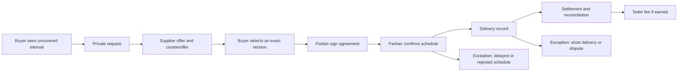

# Teder UX and backend workflow

22 November 2026 · Design companion to [implementation.md](implementation.md)

Teder helps a business buyer see where it lacks supply, obtain an offer that can cover the gap, and follow the deal through delivery. The proposed first pilot covers one retailer, one grid, and one recurring firm clean-power requirement. Storage, fuel and regional trade use the same workspace as those products become available through qualified partners. This is a design specification. The examples are fictional.

## 1. What each participant sees

| Participant | Main task | What the account can see and do |
| --- | --- | --- |
| Buyer or retailer | Cover a supply gap at a named delivery point | See its own coverage, compare invited offers, counter, request approval, select an offer, and track delivery. |
| Supplier or storage partner | Confirm how much it can commit and under which terms | See invitations and its own responses. Report available capacity, submit or revise offers, and attest commitments. No access to competing bids. |
| Scheduler, market participant or logistics partner | Confirm whether the contracted delivery has been arranged and report what happened | Access only the assigned deals and relevant fields. Supply schedule, transfer, delivery or settlement references from its system. |
| Buyer approver or signer | Authorize the commercial commitment | See exact offer and agreement versions, authority limits, remaining conditions and any Teder fee before approving or signing. |
| Teder operations | Resolve incomplete data, partner access and exceptions | See only assigned records and fields covered by the engagement. Manage eligible market configurations and review evidence. Every privileged action is recorded. |

An organization can hold several roles. Having a Teder account or a supplier role does not confer trading, dispatch or signing authority. The server checks organization membership, approved market, deal participation and the actor's limits for each protected action.

## 2. Buyer workspace and coverage

**Navigation:** Coverage · Requests · Deals · Supply sources · Markets · Billing. Each workspace shows the active organization and market. A portfolio can display several markets side by side. Each requirement stays tied to one delivery point, product and local time zone.

```text
Coverage / Singapore / Evening supply                           Example
Next delivery window       18:00–22:00 SGT      2.0 MW required

Contracted in this window  1.5 MW                6 MWh
Still to secure            0.5 MW                2 MWh
Scheduling confirmed       1.0 MW                4 MWh
Awaiting schedule           0.5 MW                2 MWh of contracted supply

[Review 0.5 MW gap]  [Create request]
```

On desktop, show coverage by interval with the side panel for the selected gap. On mobile, stack the intervals and next actions. The delivery point, dates, time zone, units and data timestamp stay visible when filtering. A market can show **Discovery only**, **Available for approved deals**, or **Unavailable**. An empty workspace offers **Add a requirement**. A feed failure shows **Data unavailable** with the last successful update.

**How the backend calculates it:**

- Record each demand interval and each eligible supply allocation separately. Check matching product, delivery point, dates and time interval. For power, derive MWh from MW × actual interval duration. Keep the market time zone and the corresponding UTC boundaries.
- **Contracted** counts allocated signed supply that meets the relevant requirement and has cleared its contractual conditions. **Scheduled** is the subset with a confirmed schedule from the responsible partner. **Delivered** and **settled** use later evidence. Each figure has a source and a time. These states are cumulative views of the same quantity. Adding them would double-count supply.
- Calculate the uncovered amount per interval before summarizing. Excess supply in one hour cannot offset a shortage in another unless a separately committed mechanism can shift it. Unknown or stale availability cannot reduce the confirmed gap.
- Never add MW, MWh and tonnes into a portfolio total. Group by delivery product and point. Only show a consolidated cost when currencies, dates and cost assumptions are comparable.

## 3. From gap to trade



| Step and screen | What the user does | Backend behavior |
| --- | --- | --- |
| **1. Create request** `/app/requests/new` | Starts from the 0.5 MW gap or enters a new delivery requirement. Reviews dates, volume, source criteria, price basis, and response deadline. | Copies the relevant interval into a draft. Validates market eligibility and product fields, derives 2 MWh for the four-hour example, assigns a request version and records the creator. |
| **2. Invite suppliers** `/app/requests/:id` | Invites approved suppliers for the named delivery point. | Checks current counterparty eligibility and audience. Publishes a versioned request and queues invitations. A material change requires supplier reconfirmation. |
| **3. Quote or counter** `/app/requests/:id` | Supplier sends a private indicative quote or firm offer. Buyer counters on timing, pricing or shortfall terms. | Stores each revision with validity, firmness, credit conditions, quantity, terms and audience. A submitted revision supersedes the previous actionable version. Indicative or expired quotes cannot be awarded. |
| **4. Compare and select** `/app/requests/:id/compare` | Compares delivered price, exact delivery point, coverage by interval, clean-source criteria, fees, and shortfall conditions. Selects a conforming full-volume offer. | Displays differences and blocks selection when a required condition is unmet. Rechecks authority, offer version, expiry and eligibility in the award write. Enforces one active award per request in the pilot. A new revision requires a fresh review. |
| **5. Sign** `/app/deals/:id` | Authorized parties review the chosen terms and sign through the agreed process. | Records the selected version and agreement separately. **Offer selected** leaves coverage unchanged. **Contracted** requires the accepted agreement and cleared conditions. Store the document privately and retain a version history for amendments. |
| **6. Schedule and deliver** `/app/deals/:id` | Assigned partner confirms the grid schedule, then reports delivery. Buyer sees what is pending and who needs to act. | Links each partner reference to the relevant intervals. Distinguishes submitted, confirmed, rejected, and revised schedules. Records actuals with the issuer, effective time and receipt time. |
| **7. Reconcile and invoice** `/app/deals/:id` and `/app/billing` | Buyer reviews the delivered and settled quantities. Teder shows the separate service fee when earned. | Keeps disagreements visible and retains original values beside corrections. Records the agreed fee trigger, payer and calculation. Manual invoicing first, with duplicate prevention and adjustment records. The buyer and seller settle the energy transaction through their agreed process. |

The deal page shows one next action and an explicit status per layer: **Agreement**, **Schedule**, **Delivery**, and **Settlement**. A missing schedule is an **Awaiting confirmation** state. A cancelled schedule or short delivery opens an exception with the responsible party, affected intervals, and next action.

## 4. Storage and supply visibility

```text
Supply sources / Partner battery                                  Example
Delivery point            Singapore pilot point
Reported capability       Up to 1 MW in the selected window
Committed elsewhere       0.5 MW
Partner offer to Teder    0.5 MW for 18:00–22:00
Required discharge       2 MWh across four hours
Status                    Firm offer · expires at the stated deadline
Schedule                  Awaiting partner confirmation
```

**Buyer view:** see the product and delivery promise, when it expires, remaining conditions, and who will deliver. Show why a source is unsuitable, such as insufficient duration or a different delivery point. The buyer sees only the availability and asset details the supplier has agreed to share.

**Supplier view:** report available MW and deliverable MWh for specific windows, submit an offer, and track its own existing commitments. An approved operator can revise availability or flag an outage. A live state-of-charge reading, if connected later, appears separately from capacity a seller has committed.

**Backend:** retain the partner's original report, timestamps, declared constraints, and matching commitments. Keep **reported availability**, **a firm offer**, and **capacity committed under contract** as separate records. Check power, energy, duration, existing allocations and market access before treating storage as eligible. Lock any inventory Teder is explicitly authorized to allocate as part of a guarded write. For inventory controlled externally, rely on the partner's reservation confirmation and flag conflicts. If a partner feed becomes stale, show the last known report and require a fresh confirmation for any new commitment.

| Source | What the same screen can show later | What the deal needs |
| --- | --- | --- |
| Solar or wind | Generation forecast and any partner-backed balancing or storage offer. | Distinguish forecast or as-generated output from a firm delivery profile. |
| Hydro | Window and quantity the hydro operator offers commercially. | Authorized supplier and a route that can deliver to the contract point. |
| Natural gas | Contracted inventory or available supply at a named pipeline or terminal. | Quantity, quality, delivery window, and relevant storage, transport and receiving rights. Distinguish a gas purchase from a gas-fired power purchase. |
| Coal | Partner-reported stockpile, grade and available shipment volume when the market supports it. | Contracted quantity, receiving location, logistics and evidence of accepted delivery. Separate from clean-power procurement. |

Teder's supply screens are for monitoring and commercial commitments. The asset operator controls physical equipment, including battery dispatch, reservoir release and terminal operations. Pilot data comes from authorized reports or file uploads. Add read-only integrations when partners agree on data access, meaning, and freshness.

## 5. Regional and cross-border delivery

**On screen:** a buyer selects a destination and sees supported delivery points and the products available there. For a linked market, the route card shows origin, destination, supported direction, named execution partner, and permission and capacity status. Maps are optional context. A straight line on a map never represents available delivery.

| Route state | What users see | What the server allows |
| --- | --- | --- |
| Discovery only | Market research or an example route with missing prerequisites. | Draft or inquiry. |
| Route pending | Named parties and endpoints, with a missing approval, access confirmation, or eligible delivery path. | Capture a conditional expression of interest where permitted. Block firm award. |
| Route eligible | Approved product and parties, defined endpoints and a permitted delivery process. | Run an eligible tender. Route eligibility alone leaves the capacity for this deal unconfirmed. |
| Delivery path confirmed | The responsible participant confirms the required rights or capacity for the particular dates and direction. | Record the confirmation and continue the deal. An operator confirmation is still required to show a schedule as confirmed. |
| Closed or interrupted | An expired authorization, outage, withdrawal, or rejected schedule. | Block new commitments that depend on it. Open an exception on affected deals and preserve their history. |

**Example:** The same buyer can see an evening power gap in Singapore and another in Japan. Teder opens separate requests at the two delivery points. A proposed import into Singapore would have its own licensed counterparty and route record before a live award. A later fuel shipment would use a load and discharge route, rather than a grid interconnector. Teder unifies the interface and lifecycle across these cases. Delivery authority and capacity remain local to each route.

## 6. Backend ownership and release checks

Use the stack proposed in [implementation.md](implementation.md): TanStack Start and Workers, oRPC and Zod for server operations, D1 for commercial records, and private R2 for evidence. Keep the energy and funds with the contracting and operating parties. The app can publish approved requests, validate eligibility, hold an offer version, enforce application permissions and record the deal.

| Backend area | Main records or jobs |
| --- | --- |
| Market access | Market, delivery point, route and eligibility records. Store scope, effective dates, source and verification responsibility. |
| Coverage | Requirements, interval-level allocations, partner availability reports, and computed coverage for contracted, scheduled and delivered stages. |
| Trade | Requests, invitations, offer revisions, awards and agreements. Award operations are conditional and idempotent. Record the state change and notification event together. |
| Partner evidence | Scheduling confirmations, delivery reports, settlement records and exceptions. Authorized uploads or read-only integrations. Deduplicate partner event IDs and reject invalid state changes. |
| Billing and audit | Fee terms, trigger, invoice and adjustments. Separate permissions for commercial evidence and billing. Use an auditable history for approvals, changes and data access. |

Build in this order:

1. **Pilot:** one eligible domestic power market, coverage, invite-only requests, firm offer comparison, one award, and manual agreement and partner evidence. Test with a buyer and at least two separate supplier accounts.
2. **Storage:** add partner availability and commitment screens when a buyer needs storage-backed delivery. Verify capacity conflicts and availability expiry before showing any offer as usable.
3. **Regional portfolio:** add a second supported market with separate local rules. Enable an import route once the parties and delivery path are verified. Add fuel-specific schemas when a buyer has an actionable requirement.

The UX is ready for a pilot when buyers can tell contracted, scheduled and delivered supply apart; a 0.5 MW gap correctly computes to 2 MWh in the four-hour example; competing suppliers cannot see each other's bids; two simultaneous award attempts cannot both succeed; an expired offer or ineligible route cannot be awarded; stale storage data cannot appear as confirmed coverage; and a short delivery stays open through correction and reconciliation. Verify these paths on desktop and mobile. Business validation still requires a real buyer to act on a usable offer, pay the agreed fee, and return with another requirement.
